## Features

Full feature-by-feature reference for the CRM: data models, API endpoints, and the real end-to-end logic (not idealized/generic flows — these reflect what the code actually does, including notable side effects and current gaps). The frontend counterpart for each feature (pages/components) lives in `crm-frontend`; see `crm-frontend/README.md` for a UI-focused index that links back here.

### 1. Leads

**Overview**: Leads represent unqualified prospects captured from marketing/sales channels. They move through a lightweight pipeline (New → Contacted → Qualified/Unqualified). Reaching the "qualified" stage triggers an automatic backend conversion into an Organization and a Contact, linking all three records together — this is the signature non-generic behavior of the module.

**Data model** (`src/leads/schemas/lead.schema.ts`)

| Field | Type | Notes |
|---|---|---|
| name, company, email | string (required) | — |
| phone, territory, notes | string (optional) | — |
| value | number | Estimated deal value (₹), default 0 |
| source | enum `LeadSource` | website, referral, linkedin, cold_outreach, event (default website) |
| status | enum `LeadStatus` | new, contacted, qualified, unqualified (default new) |
| score | number 0–100 | system-managed, shown in list/kanban |
| lastContact | Date | default now |
| organizationId, contactId | string | populated on conversion; presence guards against double-conversion |
| convertedAt | Date | set on conversion |

**Backend API** (`leads.controller.ts`)

| Method | Path | Purpose |
|---|---|---|
| POST | /leads | Create lead; fires "New lead created" notification; runs auto-conversion check |
| GET | /leads | List/paginate, filter by `status`, `source` |
| GET | /leads/:id | Fetch one |
| PATCH | /leads/:id | Update; re-runs auto-conversion check after save |
| DELETE | /leads/:id | Remove |

**Frontend UI**: `LeadsManagement.tsx` — drag-and-drop Kanban board (react-dnd) with 4 columns matching `LeadStatus`, search, delete, drag-to-move (calls update, shows a special toast when dropped into "qualified"). `LeadDetail.tsx` — hero profile, score/hot-lead badge, notes, a timeline that surfaces the "Converted to organization & contact" event, "Convert to Deal" action. `CreateLead.tsx` hosts `CreateLeadForm`.

**End-to-end flow**

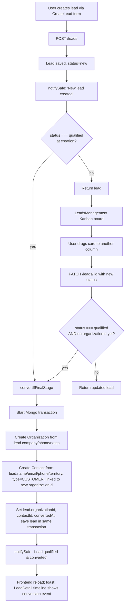

### 2. Contacts

**Overview**: Contacts are individual people (customers, partners, vendors, influencers) tied optionally to an Organization. They can be created directly by a user or automatically as a side effect of lead qualification.

**Data model** (`contact.schema.ts`)

| Field | Type | Notes |
|---|---|---|
| name, email | string (required) | — |
| title, company, phone, linkedin, location, bio | string (optional) | — |
| type | enum `ContactType` | customer, partner, vendor, influencer (default customer) |
| organizationId | string | set automatically when created via lead conversion |

**Backend API** (`contacts.controller.ts`)

| Method | Path | Purpose |
|---|---|---|
| POST | /contacts | Create (also called internally by LeadsService within a transaction, passing a Mongoose session) |
| GET | /contacts | List/paginate, filter by `type` |
| GET | /contacts/:id | Fetch one |
| PATCH | /contacts/:id | Update |
| DELETE | /contacts/:id | Remove |

`ContactsService.create` accepts an optional `ClientSession` so it can participate in the lead-conversion transaction; no notification side effects of its own.

**Frontend UI**: `ContactsManagement.tsx` — grid/list toggle, search (UI only), delete, click-through to detail. `ContactDetail.tsx` — hero card, click-through to linked Organization (only if `organizationId` is set), call/LinkedIn quick actions, actions to create a Deal or Task or edit.

**End-to-end flow**

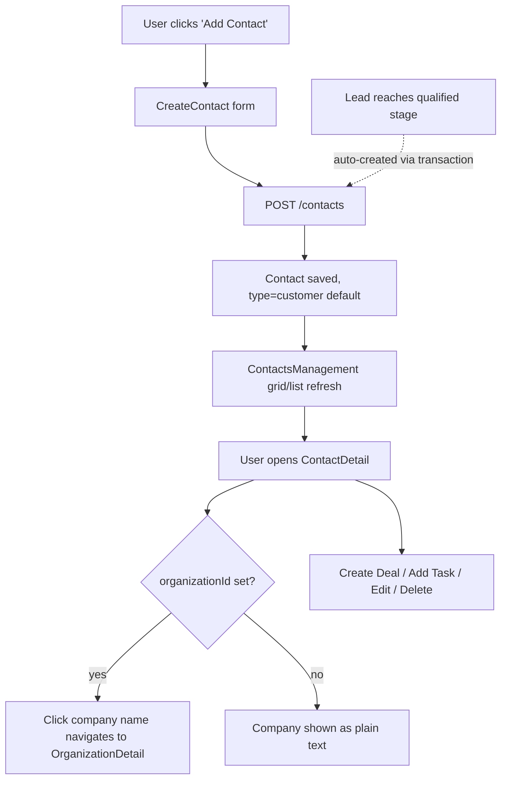

### 3. Organizations

**Overview**: Organizations represent companies/accounts. Like Contacts, they can be created directly or auto-generated when a lead is qualified (using the lead's company name as the organization name).

**Data model** (`organization.schema.ts`)

| Field | Type | Notes |
|---|---|---|
| name | string (required) | — |
| website, billingAddress, phone, description | string (optional) | — |
| industry | enum `Industry` | technology, finance, healthcare, manufacturing, retail, other (default technology) |
| type | enum `OrganizationType` | enterprise, mid_market, smb (default enterprise) |
| employeeCount | number | optional |
| annualRevenue | number | ₹, optional |

**Backend API** (`organizations.controller.ts`)

| Method | Path | Purpose |
|---|---|---|
| POST | /organizations | Create (also invoked internally by LeadsService with a transaction session) |
| GET | /organizations | List/paginate, filter by `type`, `industry` |
| GET | /organizations/:id | Fetch one |
| PATCH | /organizations/:id | Update |
| DELETE | /organizations/:id | Remove |

No notification side effects in this service.

**Frontend UI**: `OrganizationsPage.tsx` — summary stat cards (some hardcoded placeholder numbers not yet wired to live data), organization cards with tier badge, delete. `OrganizationDetail.tsx` — hero card with industry/type/revenue/employees/website/phone, "New Deal" and "Schedule" quick actions, edit/delete.

**End-to-end flow**

```mermaid
flowchart TD
    A[User clicks 'Add Organization'] --> B[CreateOrganization form]
    B --> C[POST /organizations]
    C --> D[Organization saved]
    D --> E[OrganizationsPage list refresh]

    F[Lead reaches qualified stage] -. auto-created inside transaction, name = lead.company .-> C

    E --> G[User opens OrganizationDetail]
    G --> H[View revenue/industry/employees]
    G --> I[Click 'New Deal' -> CreateDeal prefilled organizationId]
    G --> J[Edit / Delete]
```

### 4. Deals & Pipeline

**Overview**: Deals track sales opportunities through a 6-stage pipeline (discovery → qualification → proposal → negotiation → closed_won/closed_lost). The service fires a notification the moment a deal is created directly in a won stage, or transitions into one — but explicitly not on every subsequent update once already won (no repeat spam).

**Data model** (`deal.schema.ts`)

| Field | Type | Notes |
|---|---|---|
| title | string (required) | — |
| company, owner, description | string (optional) | — |
| value | number (required, default 0) | ₹ |
| closeDate | Date (optional) | — |
| stage | enum `DealStage` | discovery, qualification, proposal, negotiation, closed_won, closed_lost (default discovery) |
| priority | enum `DealPriority` | low, medium, high (default medium) |
| probability | number 0–100 | default 20 |

**Backend API** (`deals.controller.ts`)

| Method | Path | Purpose |
|---|---|---|
| POST | /deals | Create; notifies "New deal created"; if created directly into a won stage, also notifies "Deal won" |
| GET | /deals | List/paginate, filter by `stage`, `priority` |
| GET | /deals/:id | Fetch one |
| PATCH | /deals/:id | Update; compares previous vs. new stage — notifies "Deal won" only on the *transition into* a won stage |
| DELETE | /deals/:id | Remove |

Notable logic: `WON_STAGES` is a set containing `closed_won` plus tolerated frontend variants `'won'` and `'closed-won'` (defensive against inconsistent client payloads).

**Frontend UI**: `DealsAndPipeline.tsx` — drag-and-drop Kanban across 6 stage columns, value totals per column, delete, drag-to-move. `DealDetail.tsx` — hero card, 5-segment stage progress bar (closed_lost shown as a distinct red banner), win-probability bar, days-to-close counter. Lead/Contact/Organization detail pages all route into `CreateDeal` prefilled with `leadId`/`contact`/`organizationId`.

**End-to-end flow**

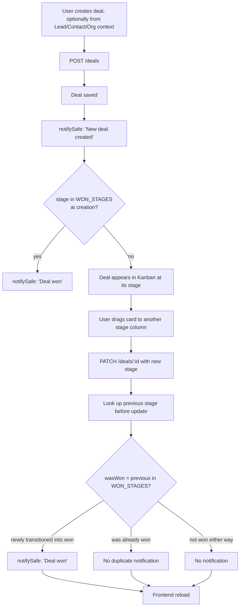

### 5. Tasks

**Overview**: Tasks are simple to-do items (follow-ups, demos, proposals, contracts, etc.) that can optionally be tied to an assignee and a free-text `relatedTo` reference. Creating a task with an assignee fires an assignment notification.

**Data model** (`task.schema.ts`)

| Field | Type | Notes |
|---|---|---|
| title | string (required) | — |
| dueDate | Date (optional) | — |
| dueTime | string | "HH:mm", paired with dueDate |
| assignee, relatedTo, description | string (optional) | relatedTo is free text (not a real FK) |
| priority | enum `TaskPriority` | low, medium, high, urgent (default medium) |
| category | enum `TaskCategory` | follow_up, meeting, demo, proposal, contract, other (default follow_up) |
| status | enum `TaskStatus` | pending, in_progress, completed (default pending) |

**Backend API** (`tasks.controller.ts`)

| Method | Path | Purpose |
|---|---|---|
| POST | /tasks | Create; if `assignee` is set, fires "Task assigned" notification (non-fatal, swallowed on failure) |
| GET | /tasks | List/paginate, filter by `status`, `priority` |
| GET | /tasks/:id | Fetch one |
| PATCH | /tasks/:id | Update (no notification side effects) |
| DELETE | /tasks/:id | Remove |

**Frontend UI**: `TasksAndProductivity.tsx` — stat cards (computed client-side from `isPast`/`isToday`), all/pending/completed filter tabs, checkbox toggles status optimistically then reloads. `TaskDetail.tsx` — hero card with due date/time, assignee, priority, relatedTo, description, days-until-due counter.

**End-to-end flow**

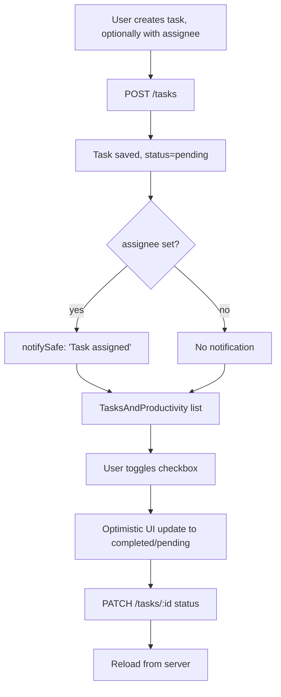

### 6. Meetings

**Overview**: Meetings schedule video/phone/in-person events with a reminder lead time. This is the simplest module — plain CRUD with no notifications, no auto-conversion, and no cross-entity side effects in the backend service.

**Data model** (`meeting.schema.ts`)

| Field | Type | Notes |
|---|---|---|
| title | string (required) | — |
| date | Date (required) | — |
| time | string (required) | "HH:mm" |
| type | enum `MeetingType` | video, phone, in-person (default video) |
| duration | number | minutes, default 30 |
| location, agenda | string (optional) | — |
| reminders | number | minutes before meeting, default 15 |

**Backend API** (`meetings.controller.ts`)

| Method | Path | Purpose |
|---|---|---|
| POST | /meetings | Create |
| GET | /meetings | List/paginate, filter by `type` |
| GET | /meetings/:id | Fetch one |
| PATCH | /meetings/:id | Update |
| DELETE | /meetings/:id | Remove |

**Frontend UI**: `MeetingsAndCalls.tsx` — "Upcoming Meetings" list backed by the API, plus a "Recent Calls"/"This Week"/"Calendar" panel that uses hardcoded mock data, not wired to any backend endpoint. `MeetingDetail.tsx` — hero card with type icon, time/duration/location/reminders, agenda. Contact/Organization detail pages expose a "Schedule" button that navigates to `/meetings/new` (no prefill).

**End-to-end flow**

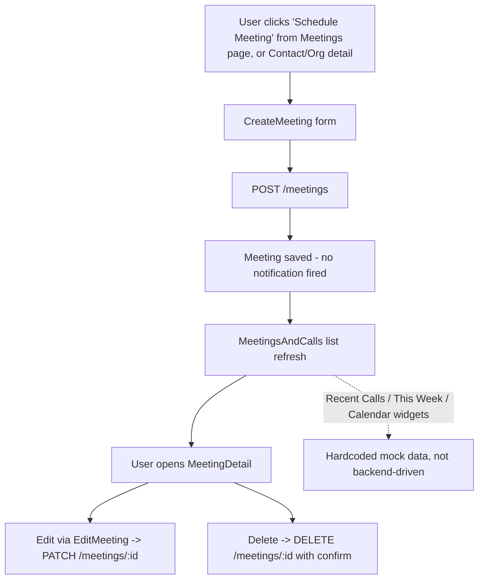

### 7. Campaigns

**Overview**: A marketing-campaign tracker (name, type, status, dates, budget, audience, goal). Plain CRUD only — there is no send/dispatch/launch mechanism anywhere in the module; `status` (draft/scheduled/active) is a manually-set label that nothing transitions automatically.

**Data model** (`campaigns/schemas/campaign.schema.ts`)

| Field | Type | Notes |
|---|---|---|
| name | string (required) | — |
| type | enum `CampaignType` | email, social, webinar, ads, event (default email) |
| status | enum `CampaignStatus` | draft, scheduled, active (default draft) — no completed/paused/cancelled |
| startDate/endDate | Date | — |
| budget | number | — |
| targetAudience, goal, description | string | — |

**Backend API** (`campaigns.controller.ts`)

| Method | Path | Purpose |
|---|---|---|
| POST | /campaigns | Create |
| GET | /campaigns | List/paginate, filter by `status`, `type` |
| GET | /campaigns/:id | Fetch one |
| PATCH | /campaigns/:id | Update |
| DELETE | /campaigns/:id | Remove |

**Frontend UI**: `CampaignManagement.tsx` — list view (some stat cards hardcoded/mock). `CampaignDetail.tsx` — read-only detail, no send/launch action. `CreateCampaign.tsx`/`EditCampaign.tsx` — thin wrappers around `CreateCampaignForm`.

**End-to-end flow**

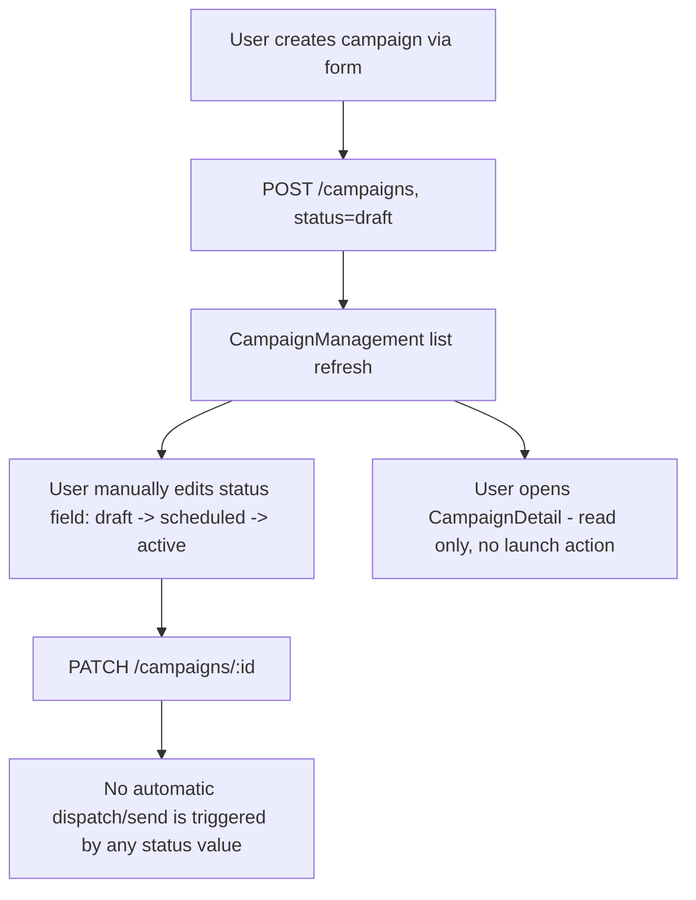

### 8. Templates

**Overview**: A reusable message library with `{{token}}` placeholders and a server-side `render()` endpoint that does string interpolation only — it does not send anything itself.

**Data model** (`templates/schemas/template.schema.ts`)

| Field | Type | Notes |
|---|---|---|
| name | string (required) | — |
| subject, content | string | content required, contains `{{token}}` placeholders |
| category | enum `TemplateCategory` | Sales, Communication, Deals, Onboarding, Follow-up, Marketing (default Sales) |
| tags | string[] | default `[]` |
| usageCount | number | default 0 |
| lastUsedAt | Date | — |

**Backend API** (`templates.controller.ts`)

| Method | Path | Purpose |
|---|---|---|
| POST | /templates | Create |
| GET | /templates | List/paginate, filter by `category` |
| GET | /templates/:id | Fetch one |
| PATCH | /templates/:id | Update |
| DELETE | /templates/:id | Remove |
| POST | /templates/:id/render | Interpolates `{{token}}` placeholders with supplied vars, returns `{ subject, body }` |

Render logic (`templates.service.ts`): `text.replace(/\{\{\s*([\w.]+)\s*\}\}/g, (_m, token) => vars?.[token] == null ? '' : String(vars[token]))`.

**Frontend UI**: `TemplateManagement.tsx` — create/delete, AI-generate content (`aiApi.generateEmail`), "Use Template" navigates to `/email/compose` via router state (no API call — the frontend does its own client-side copy of subject/content rather than calling `/templates/:id/render`). Edit/Duplicate menu items are currently dead UI (no handlers wired).

**End-to-end flow**

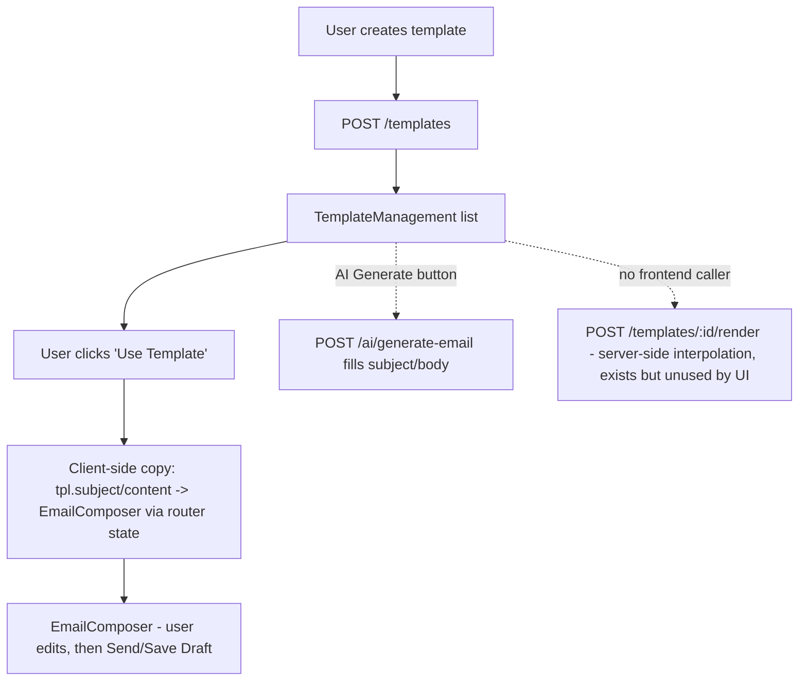

### 9. Email

**Overview**: A hybrid "email records + real send" system. All messages (inbox/sent/drafts) are stored as MongoDB documents, and there is exactly one real send path — outbound via Gmail SMTP (nodemailer). There is **no IMAP/inbox fetching**: "Inbox" is whatever `EmailMessage` documents exist with `mailbox: 'inbox'` (seeded/manually created), not synced live from a real mailbox.

**Data model** (`email/schemas/email-message.schema.ts`)

| Field | Type | Notes |
|---|---|---|
| mailbox | enum `EmailMailbox` | inbox, sent, drafts |
| from | string (required) | — |
| to | string[] (required) | — |
| cc, bcc | string[] (optional) | — |
| subject, body | string (required) | body is HTML |
| read, starred | boolean | default false |
| sentAt, receivedAt | Date (optional) | — |
| relatedEntityType, relatedEntityId | string (optional) | CRM linkage |

**Backend API** (`email.controller.ts`, base `/email`)

| Method | Path | Purpose |
|---|---|---|
| POST | /email/send | Real send via nodemailer + saves a `sent` record |
| POST | /email/messages | Create a raw message record (e.g. save draft) |
| GET | /email/messages | List, paginated, filter by `mailbox` |
| GET | /email/messages/:id | Get one |
| PATCH | /email/messages/:id | Update |
| DELETE | /email/messages/:id | Delete |
| PATCH | /email/messages/:id/read | Mark read (defaults true) |
| PATCH | /email/messages/:id/star | Toggle starred |

Send logic (`email.service.ts`): lazily builds and caches a `nodemailer.createTransport({ service: 'gmail', auth: { user: GMAIL_USER, pass: GMAIL_APP_PASSWORD } })`; throws 503 if env vars are missing rather than crashing on boot. After a successful send it writes a `SENT` record for history. The workflow engine's `action.send_email` node also calls this same `send()` method, treating a send failure as a non-fatal "skipped" step.

**Frontend UI**: `EmailInbox.tsx` — list per mailbox, search (client-side), star/read toggles. `EmailDetail.tsx` — auto-marks read on open; "Reply" navigates to `/email/compose` with prefilled state (doesn't send directly). `EmailComposer.tsx` — the only page that actually sends; loads templates, has an AI-generate button (`aiApi.generateEmail`), "Send" → `POST /email/send`, "Save Draft" → `POST /email/messages`.

**End-to-end flow**

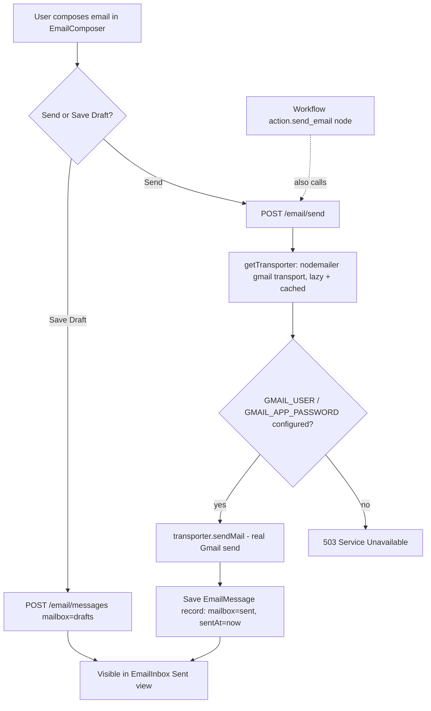

### 10. Notifications

**Overview**: In-app notification records (bell icon feed) written to Mongo by various backend modules as side effects of business events. No push/email delivery — purely a polled/listed DB feed the frontend reads.

**Data model** (`notifications/schemas/notification.schema.ts`)

| Field | Type | Notes |
|---|---|---|
| title | string (required) | — |
| message | string (optional) | — |
| type | enum `NotificationType` | deal, lead, ai, email, meeting, alert, info, success, warning, error (default info) |
| read | boolean | default false |
| link, relatedEntityType, relatedEntityId | string (optional) | — |

**Backend API** (`notifications.controller.ts`, base `/notifications`)

| Method | Path | Purpose |
|---|---|---|
| POST | /notifications | Create |
| GET | /notifications | List, paginated, filter by `type`/`read` |
| PATCH | /notifications/read-all | Mark all unread → read (bulk) |
| GET | /notifications/:id | Get one |
| PATCH | /notifications/:id/read | Mark one read |
| PATCH | /notifications/:id | Update |
| DELETE | /notifications/:id | Delete |

**Frontend UI**: `NotificationsCenter.tsx` — stat cards (total/deals/AI/alerts, computed client-side), click-to-mark-read, "Mark All Read", icon/color per `type`.

**Cross-module triggers** (who actually calls `NotificationsService.create`):

| Module | Trigger event | type / title |
|---|---|---|
| `leads.service.ts` | New lead created | LEAD, "New lead created" |
| `leads.service.ts` | Lead qualified & converted | LEAD, "Lead qualified & converted" |
| `deals.service.ts` | New deal created | DEAL, "New deal created" |
| `deals.service.ts` | Deal transitions into won stage | SUCCESS, "Deal won" |
| `tasks.service.ts` | Task created with an assignee | INFO, "Task assigned" |
| `workflows.service.ts` | `action.notify_team` node executes | from node config |

Leads/Deals/Tasks wrap the call in a `notifySafe()`/inline try-catch so a notification failure never breaks the primary write.

**End-to-end flow**

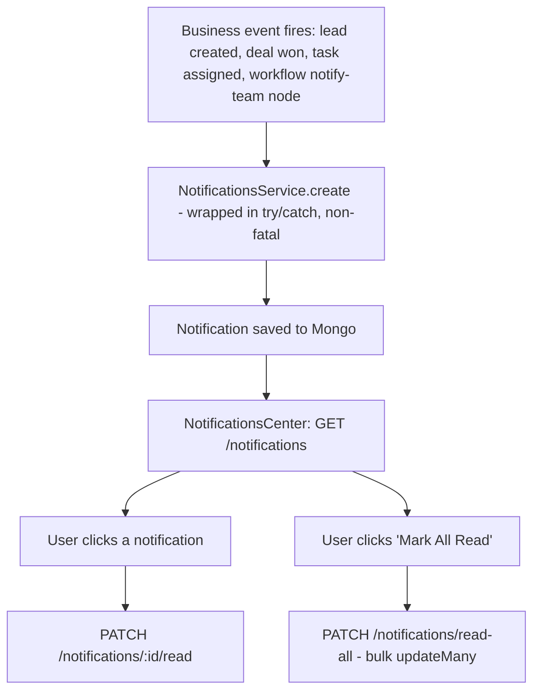

### 11. Workflows & Automation

**Overview**: Workflows automate CRM actions through a visual node graph. Each `Workflow` document stores a trigger, a set of `nodes`/`edges` (XYFlow canvas shape), and a status. Users build workflows by hand on a drag-and-drop canvas, or describe an automation in plain English to an AI generator that produces the same graph shape via OpenAI. Executing a workflow walks the graph from its entry node(s), dispatches each node to a real backend side-effect handler, and records every step into a `WorkflowRun` for auditability.

**Data model** (`workflows/schemas/workflow.schema.ts`, `workflow-run.schema.ts`)

| Field | Type | Notes |
|---|---|---|
| name, description | string | — |
| status | enum `WorkflowStatus` | draft, active, paused (default draft) |
| trigger | `{ type: string; config?: object }` | free-form |
| nodes | `WorkflowNode[]` | `{ id, type, position:{x,y}, data }` |
| edges | `WorkflowEdge[]` | `{ id, source, target, ... }` (condition branches carry a label) |

**Executable node `type` values** (prefix-dispatched by the execution engine):

| Type | Kind | Handler |
|---|---|---|
| `trigger.*` (e.g. `trigger.new_lead`, `trigger.scheduled`) | trigger | no-op entry point |
| `condition.*` (e.g. `condition.if_else`) | condition | evaluates `{field, operator, value}` (equals/not_equals/contains); branches true/false |
| `action.create_task` | action | `TasksService.create` |
| `action.send_email` | action | `EmailService.send` (skips silently if unconfigured) |
| `action.notify_team` | action | `NotificationsService.create` |
| `action.update_crm` | action | dispatches to Leads/Deals/Tasks `.update` by `data.entity` |
| `action.log` / unrecognized | action | no-op |

**WorkflowRun**: `{ workflowId, startedAt, finishedAt, status: running|success|failed, steps: [{ nodeId, type, status, output?, error?, timestamp }], triggerPayload }`.

**Backend API** (`workflows.controller.ts`)

| Method | Path | Purpose |
|---|---|---|
| POST | /workflows | Create workflow |
| GET | /workflows | List (paginated, filter by `status`) |
| GET | /workflows/:id | Get one |
| PATCH | /workflows/:id | Update |
| DELETE | /workflows/:id | Delete |
| GET | /workflows/:id/runs | Execution history (paginated) |
| DELETE | /workflows/:id/runs | Clear execution history |
| POST | /workflows/:id/execute | Run now, body `{ triggerPayload? }` |
| POST | /ai/generate-workflow | AI-generate a node/edge graph from a text prompt |

**Frontend UI**: `WorkflowAutomation.tsx` — list/grid with stat cards, status badges, quick activate/pause toggle. `WorkflowBuilder.tsx` — drag-and-drop XYFlow canvas (node library sidebar → canvas), config panel per node, "Save Workflow". `WorkflowDetail.tsx` — read-only canvas render, execution stats, "Run Now", activate/pause/delete, execution history. `AIWorkflowGenerator.tsx` — prompt → `POST /ai/generate-workflow` → preview on canvas (mapping dotted types to renderer node types) → "Save as Workflow" persists the original AI JSON via `POST /workflows`.

**End-to-end flow**

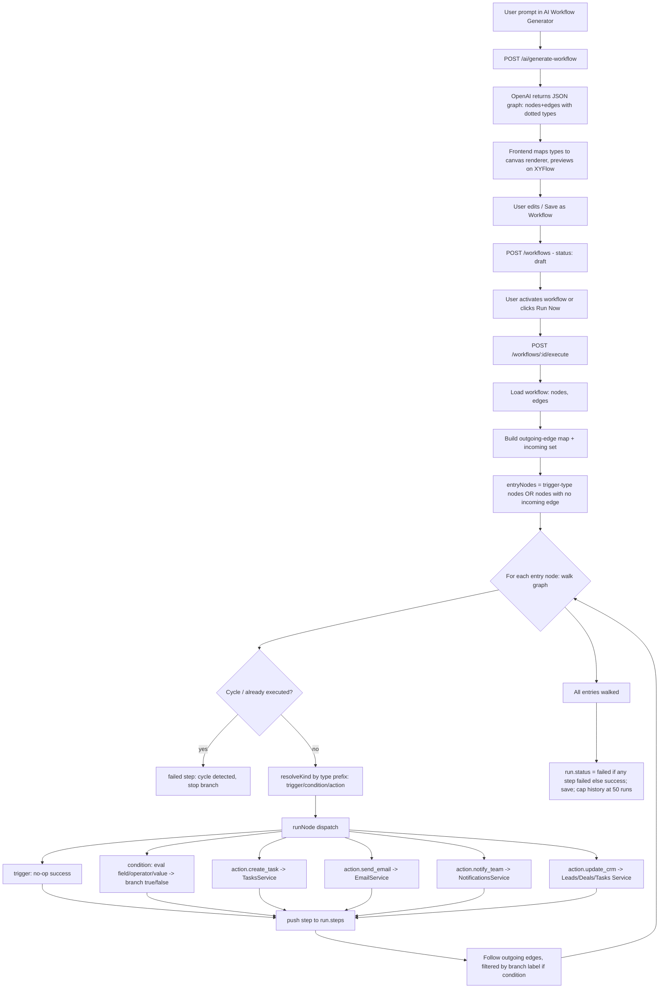

### 12. Team Collaboration

**Overview**: Two lightweight, flat data structures — discussion **Threads** (with an embedded message list) and standalone **SharedNotes** — plus a cross-cutting **Mentions** feed that scans both for `@name` patterns. No per-user access control: a thread or note is implicitly visible to everyone once created, and messages are simple appended subdocuments (no reply nesting).

**Data model** (`collaboration/schemas/thread.schema.ts`, `shared-note.schema.ts`)

| Field | Type | Notes |
|---|---|---|
| Thread.title | string | — |
| Thread.participants | string[] | default `[]` |
| Thread.messages | `{ author, text, timestamp }[]` | flat, embedded |
| Thread.tags | string[] | default `[]` |
| Thread.unread | number | default `0`; never incremented by the service |
| SharedNote.title, content, author | string | author required |
| SharedNote.tags | string[] | default `[]` |

**Backend API**

| Method | Path | Purpose |
|---|---|---|
| POST | /collaboration/threads | Create thread |
| GET | /collaboration/threads | List (paginated, filter by `tag`) |
| GET / PATCH / DELETE | /collaboration/threads/:id | Get / update / delete |
| POST | /collaboration/threads/:id/messages | Append `{ author, text }`, server sets `timestamp` |
| POST | /collaboration/notes | Create shared note |
| GET / GET:id / PATCH / DELETE | /collaboration/notes... | Standard CRUD (paginated list filters by `tag`) |
| GET | /collaboration/mentions | Aggregated `@mention` feed across thread messages and note content |

**Frontend UI**: `TeamCollaboration.tsx` — stat cards (some hardcoded), a conversation list, a read-only Shared Notes panel, a Mentions panel, and a Quick Message composer that posts to the selected thread always as hardcoded author `"You"` (no real identity/auth wiring yet).

**End-to-end flow**

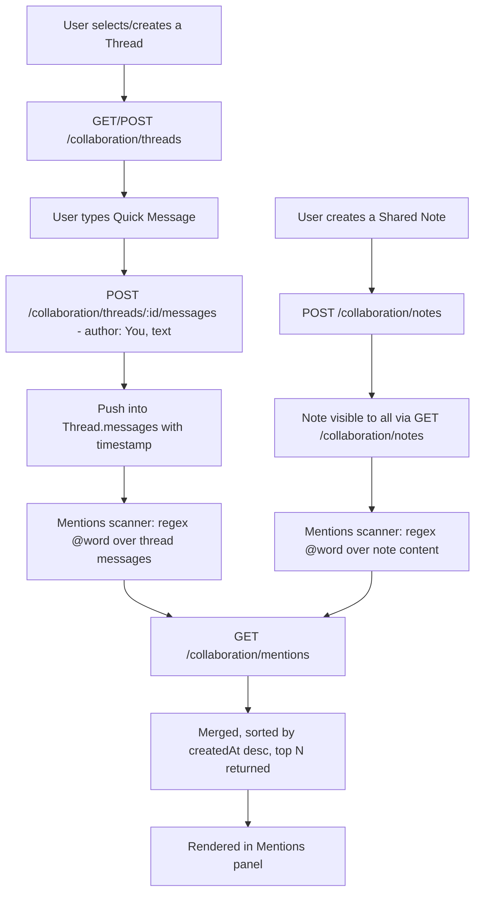

### 13. Integrations Marketplace

**Overview**: A catalog of third-party integrations (Slack, Zoom, payment providers, etc.) presented as a browsable, filterable grid. "Connecting"/"disconnecting" are simple status-flip operations, not real OAuth/credential exchanges — actual API keys or webhook URLs would live in a freeform `config` object updated separately via the generic `PATCH` endpoint.

**Data model** (`integrations/schemas/integration.schema.ts`)

| Field | Type | Notes |
|---|---|---|
| name, description | string | — |
| category | enum `IntegrationCategory` | Communication, Productivity, Payments, CRM, Automation, Marketing, Video, Social |
| iconKey | string | maps to a frontend icon component |
| status | enum `IntegrationStatus` | available (default), connected, disconnected |
| connectedAt | Date | set on connect, cleared on disconnect |
| config | object | freeform — no enforced shape |

**Backend API** (`integrations.controller.ts`)

| Method | Path | Purpose |
|---|---|---|
| POST | /integrations | Create integration record |
| GET | /integrations | List (paginated, filter by `category`) |
| GET | /integrations/:id | Get one |
| PATCH | /integrations/:id | Update (e.g. write `config`) |
| PATCH | /integrations/:id/connect | Set status=connected, connectedAt=now |
| PATCH | /integrations/:id/disconnect | Set status=disconnected, connectedAt=null |
| DELETE | /integrations/:id | Delete |

**Frontend UI**: `IntegrationMarketplace.tsx` — card grid, client-side category/search filtering, Connect/Disconnect button per card. "Manage Connections" and "Request Integration" buttons are present but not wired to handlers.

**End-to-end flow**

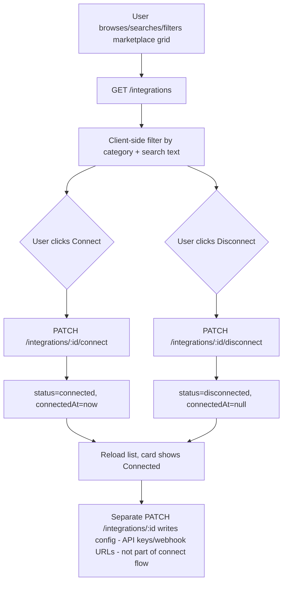

### 14. Dashboard

**Overview**: The CRM's landing page — headline stats, a 12-month revenue trend, a lead-to-won conversion funnel, and a unified recent-activity feed pulled live from Mongo. No caching layer; every request recomputes via live aggregation/count queries.

**Data sources** (`dashboard/dashboard.service.ts`, reads `Lead`, `Deal`, `Task`, `Meeting`)

- `getStats()` — total leads; deal count + summed value; tasks due today/overdue; meetings in the next 7 days.
- `getRevenue()` — trailing 12 months of deal value by `closeDate ?? createdAt`, zero-filled.
- `getConversionFunnel()` — Leads → Qualified → Proposal/Negotiation/Won → Won.
- `getActivity(limit)` — merges most-recently-updated leads/deals/tasks/meetings into one timeline.

**Backend API**

| Method | Path | Purpose |
|---|---|---|
| GET | /dashboard/stats | Headline KPI tiles |
| GET | /dashboard/revenue | 12-month revenue series |
| GET | /dashboard/activity | Merged recent-activity feed |
| GET | /dashboard/conversion-funnel | Funnel counts |

**Frontend UI**: `Dashboard.tsx` — 4 independent `useApiQuery` calls (one per endpoint, each with its own loading/error state), stat tiles, a Recharts `AreaChart` for revenue, a `BarChart` funnel with a client-computed "% converted" bar, and a "Global Activity Stream" list.

**End-to-end flow**

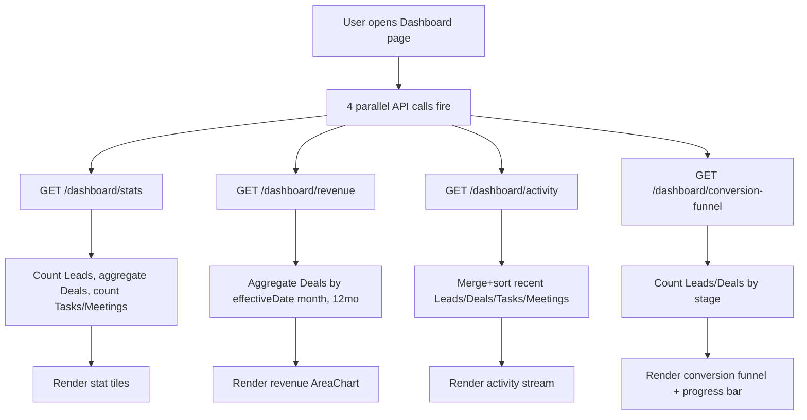

### 15. Analytics

**Overview**: A deeper view of pipeline performance: revenue trend, lead source mix, and team performance, plus (consumed by AI Insights Center) a revenue forecast and deal-size segmentation. Every number is a real Mongo aggregation.

**Data sources** (`analytics/analytics.service.ts`, reads `Lead`, `Deal`)

- `getRevenueByMonth()` — same logic as Dashboard's revenue.
- `getLeadsBySource()` — lead count by source, zero-filled across every enum value.
- `getTeamPerformance()` — deals grouped by `owner`: count + revenue, sorted descending.
- `getForecast()` — 12-month `actual` (won deal value) vs. `forecast` (probability-weighted value across all deals).
- `getSegments()` — deal count bucketed by value tier (Small/Medium/Large/Enterprise).

**Backend API**

| Method | Path | Purpose |
|---|---|---|
| GET | /analytics/revenue-by-month | 12-month revenue series |
| GET | /analytics/leads-by-source | Lead counts by channel |
| GET | /analytics/team-performance | Deals + revenue per owner |
| GET | /analytics/forecast | Actual vs. probability-weighted forecast |
| GET | /analytics/segments | Deal counts by value tier |

**Frontend UI**: `AnalyticsDashboard.tsx` — calls revenue-by-month/leads-by-source/team-performance directly; 4 stat cards computed client-side from the fetched series (no dedicated summary endpoint); revenue `AreaChart`, leads-by-source `PieChart`, team-performance grouped `BarChart`. `getForecast`/`getSegments` are instead consumed by AI Insights Center.

**End-to-end flow**

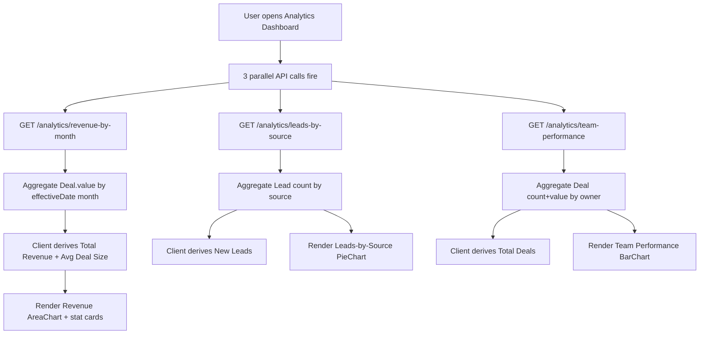

### 16. AI Copilot

**Overview**: A global, always-available chat drawer — not a page — that lets any user ask natural-language questions about the CRM from wherever they are. Grounded in real CRM data via a snapshot built from Mongo at request time, aware of the page/entity the user is viewing, and able to call live lookup tools (OpenAI function-calling) instead of guessing.

**Data sources** (`ai/ai.service.ts`): `buildCrmSnapshot()` pulls the first 100 leads/deals/tasks via `LeadsService`/`DealsService`/`TasksService` and derives totals, open pipeline value, won count, overdue task count, and up to 5 "stale" deals (open >14 days since `updatedAt`). Four OpenAI tools give live, on-demand lookups: `find_deal`, `find_lead` (substring match), `list_overdue_tasks`, `get_pipeline_summary`.

**Backend API**

| Method | Path | Purpose |
|---|---|---|
| POST | /ai/copilot | Chat turn: `{ message, history?, pageContext? }` → `{ reply }`, up to 2 rounds of tool-calling |
| POST | /ai/insights | Also used by the copilot drawer on open (see AI Insights Center) |

**Frontend UI**: `AICopilot.tsx` — a fixed slide-in drawer, not mounted to any route; rendered once in `RootLayout.tsx`, toggled from the sidebar, reachable from every page. `RootLayout.tsx` derives `pageContext` (`{entityType, entityId, path}`) from `useLocation()` on every render and passes it down; it's forwarded on both the insights fetch and every chat message. Chat history is local component state only (not persisted).

**End-to-end flow**

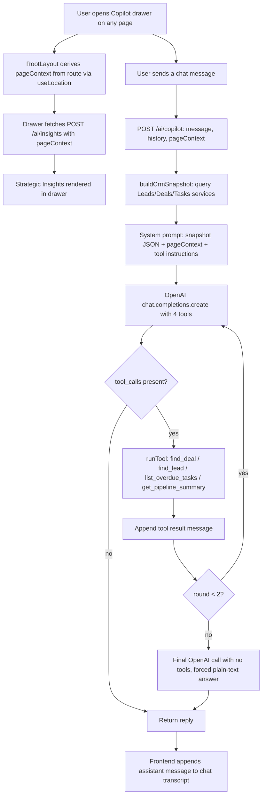

### 17. AI Insights Center

**Overview**: A dedicated analytics page combining OpenAI-generated, CRM-grounded insights/predictions with real Analytics data (forecast and segments). Several top KPI tiles are still explicit placeholders pending a backend endpoint.

**Data sources**: `POST /ai/insights` → `AiService.getInsights()` builds the same `buildCrmSnapshot()` as the Copilot (or accepts a caller-supplied `context`), sends it to OpenAI with a system prompt demanding strict JSON `{ insights: [...], predictions: [...] }` (no tool-calling here — single request/response). `GET /analytics/forecast` and `GET /analytics/segments` are real Mongo aggregations, not AI-generated, despite living on this page. The four top stat cards (Predicted Revenue, Pipeline Velocity, Conversion Lift, Risk Exposure) are hardcoded placeholders with a `TODO` noting no backend endpoint exposes them yet.

**Backend API**

| Method | Path | Purpose |
|---|---|---|
| POST | /ai/insights | 3–5 severity-tagged insights + 2–4 confidence-scored predictions from the CRM snapshot |
| GET | /analytics/forecast | Actual vs. forecast revenue by month |
| GET | /analytics/segments | Deal counts by value tier |

**Frontend UI**: `AIInsightsCenter.tsx` — 4 placeholder stat tiles; "Revenue Forecast" `AreaChart`; "AI Confidence Engine" (predictions as progress bars); "Revenue Mix" donut; "Priority Insights" cards color/icon-coded by severity; a static "Ask AI Analyst" prompt box that is UI-only (not wired to a submit handler).

**End-to-end flow**

```mermaid
flowchart TD
    A[User opens AI Insights Center] --> B[3 parallel API calls fire]
    B --> C[POST /ai/insights - no pageContext]
    B --> D[GET /analytics/forecast]
    B --> E[GET /analytics/segments]
    C --> F[buildCrmSnapshot: query Leads/Deals/Tasks]
    F --> G[System prompt demands strict JSON: insights[] + predictions[]]
    G --> H[OpenAI call, response_format json_object, no tools]
    H --> I[Parse JSON: insights + predictions]
    D --> J[Actual vs probability-weighted forecast by month]
    E --> K[Deal counts by value bucket]
    I --> L[Render Priority Insights cards + Confidence Engine bars]
    J --> M[Render Revenue Forecast AreaChart]
    K --> N[Render Revenue Mix donut]
```

## Deployment

When you're ready to deploy your NestJS application to production, there are some key steps you can take to ensure it runs as efficiently as possible. Check out the [deployment documentation](https://docs.nestjs.com/deployment) for more information.

If you are looking for a cloud-based platform to deploy your NestJS application, check out [Mau](https://mau.nestjs.com), our official platform for deploying NestJS applications on AWS. Mau makes deployment straightforward and fast, requiring just a few simple steps:

```bash
$ npm install -g @nestjs/mau
$ mau deploy
```

With Mau, you can deploy your application in just a few clicks, allowing you to focus on building features rather than managing infrastructure.

## Resources

Check out a few resources that may come in handy when working with NestJS:

- Visit the [NestJS Documentation](https://docs.nestjs.com) to learn more about the framework.
- For questions and support, please visit our [Discord channel](https://discord.gg/G7Qnnhy).
- To dive deeper and get more hands-on experience, check out our official video [courses](https://courses.nestjs.com/).
- Deploy your application to AWS with the help of [NestJS Mau](https://mau.nestjs.com) in just a few clicks.
- Visualize your application graph and interact with the NestJS application in real-time using [NestJS Devtools](https://devtools.nestjs.com).
- Need help with your project (part-time to full-time)? Check out our official [enterprise support](https://enterprise.nestjs.com).
- To stay in the loop and get updates, follow us on [X](https://x.com/nestframework) and [LinkedIn](https://linkedin.com/company/nestjs).
- Looking for a job, or have a job to offer? Check out our official [Jobs board](https://jobs.nestjs.com).

## Support

Nest is an MIT-licensed open source project. It can grow thanks to the sponsors and support by the amazing backers. If you'd like to join them, please [read more here](https://docs.nestjs.com/support).

## Stay in touch

- Author - [Kamil Myśliwiec](https://twitter.com/kammysliwiec)
- Website - [https://nestjs.com](https://nestjs.com/)
- Twitter - [@nestframework](https://twitter.com/nestframework)

## License

Nest is [MIT licensed](https://github.com/nestjs/nest/blob/master/LICENSE).
